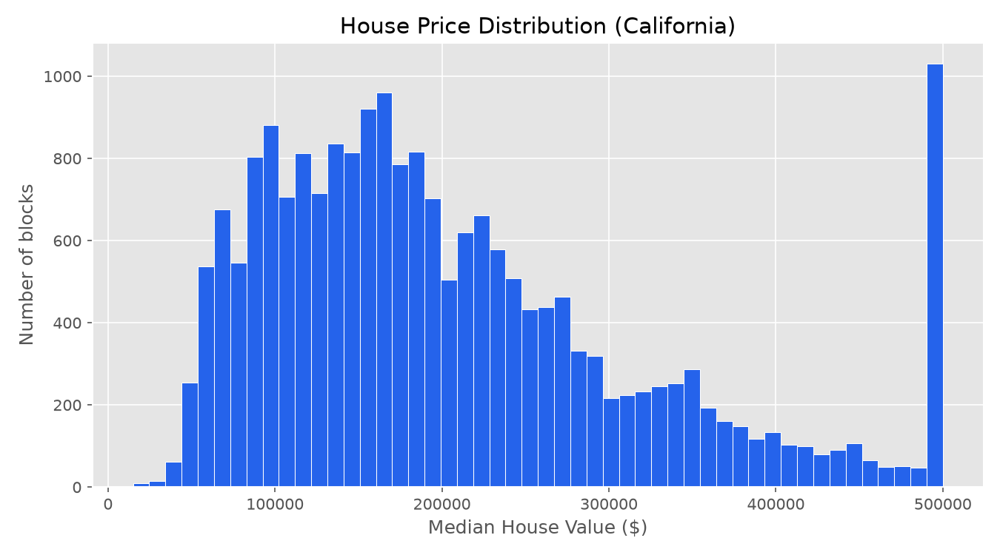
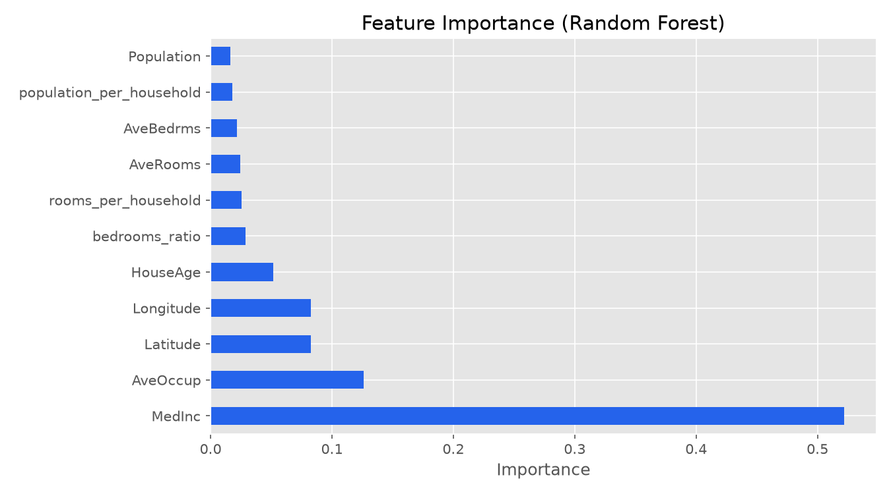
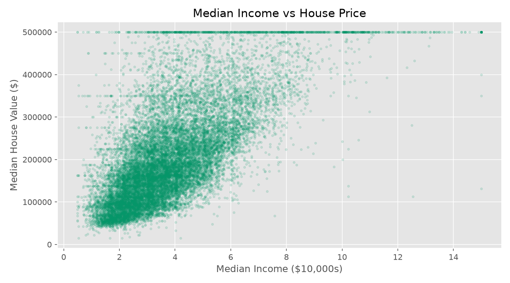
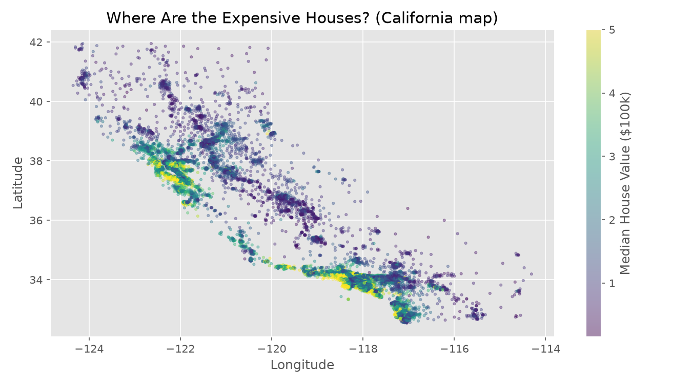

# 🏠 House Price Prediction

Can we guess a house price from its income, age, rooms and location? I tried it on real data — 20,640 houses from California, USA.



## The data (real, not made up)

- **Dataset:** California Housing — 20,640 houses, 1990 US Census
- **Source:** scikit-learn `fetch_california_housing` (originally Pace & Barry, 1997) — https://scikit-learn.org/stable/datasets/real_world.html#california-housing-dataset
- **Target:** `MedHouseVal` — median house value in a block, in $100,000s (so 2.07 means about $207,000)
- **Features:** median income, house age, average rooms, average bedrooms, population, average occupancy, latitude, longitude — plus 3 features I made myself: rooms per household, bedrooms ratio, population per household
- **Missing values:** none — I checked, all 9 columns are complete

## Results (honest numbers, test set = 4,128 houses)

| Model | R² | MAE | RMSE | 5-fold CV R² |
|---|---:|---:|---:|---:|
| Linear Regression | 0.6535 | 0.4874 | 0.6738 | 0.6593 ± 0.0195 |
| **Random Forest** | **0.8065** | **0.3280** | **0.5035** | **0.8039 ± 0.0052** |
| Gradient Boosting | 0.7788 | 0.3668 | 0.5384 | 0.7897 ± 0.0026 |

MAE is in $100,000s — so Random Forest is off by about **$32,800** on average, and its RMSE is about **$50,350**. Not perfect, but much better than a straight line: house prices are not linear.

## What matters most?



1. **Median income — 0.522** (by far the biggest factor)
2. Average occupancy — 0.126
3. Latitude — 0.082 and Longitude — 0.082 (location: coastal areas cost more)
4. House age — 0.052




## How to run

```bash
pip install -r requirements.txt
python analysis.py
```

Or open it in Jupyter — same steps, easy words, charts inside:

```bash
jupyter notebook analysis.ipynb
```

`analysis.py` saves the charts in `outputs/` and the numbers in `outputs/results.txt` and `outputs/model_comparison.csv`.

## What I learned

- Tree models beat Linear Regression here, because price does not grow in a straight line with income or rooms.
- Income matters more than the house itself — a rich area costs more even for an old house.
- Prices in this dataset are capped at $500,000, so very expensive houses all look the same to the model. That is a real limit of the data.

## Limits (please read)

- This is **California, USA data — not Bangladesh**. I cannot use this model for Dhaka flat or rent prices directly.
- The target is a *block* median, not one single house.
- I did not tune the models a lot — a tuned model could do a bit better, but these are the real numbers I got.

## Files

| File | What it is |
|---|---|
| `analysis.py` | Full analysis: load, clean, train, evaluate, charts |
| `analysis.ipynb` | Same steps in Jupyter, in easy words (verified: runs with 0 errors) |
| `data/california_housing.csv` | The real dataset (20,640 rows) |
| `outputs/` | 7 charts, `results.txt`, `model_comparison.csv`, `feature_importance.csv` |
| `REPORT.md` | Short report: data, method, results, limits |

— Md Emon Rana, CSE, Southeast University
